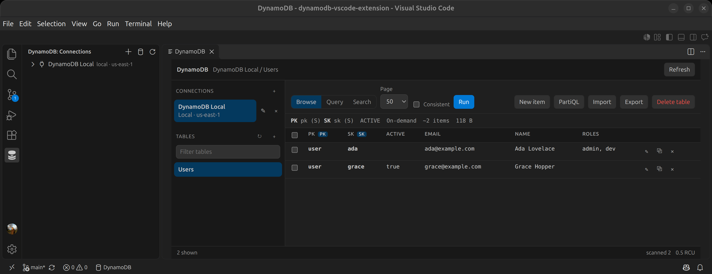
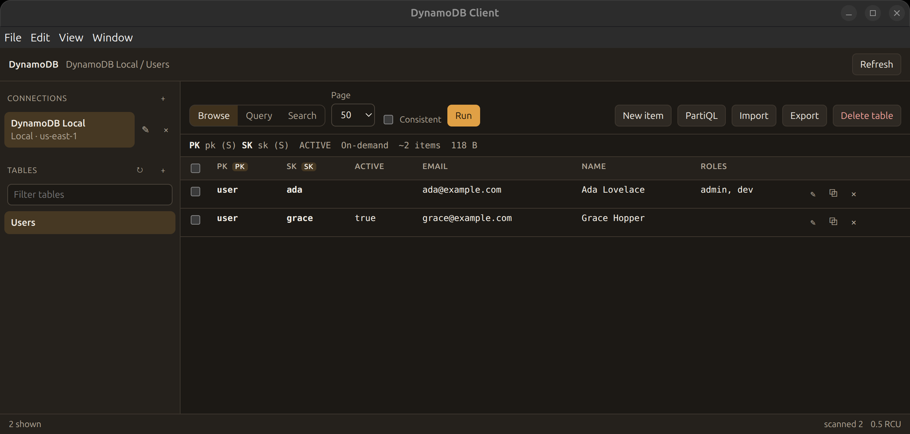

# DynamoDB Client user guide

DynamoDB Client is the same screen in two apps: a VS Code extension, and a desktop app for Linux and macOS. You connect to a table, page through items, query keys, search text, and create, edit, or delete items.

The pictures below are the live apps against DynamoDB Local, with a `Users` table that holds two items.

## VS Code extension

Install the extension, then open **DynamoDB** in the activity bar. The sidebar lists connections. Expand a connection to see its tables. Click a connection or a table, or run **DynamoDB: Open Client** from the Command Palette. The client opens as an editor tab named DynamoDB.



The activity bar and the **DynamoDB: Connections** view are VS Code. The editor tab is the shared client.

## Desktop app

Open **DynamoDB Client**. Linux and macOS use the same window. The picture is Linux. On macOS the menus sit in the system menu bar at the top of the screen: DynamoDB Client, Edit, View, and Window.



From a checkout of this repo, `bun run dev:desktop` starts that window. `bun run package:desktop` builds an AppImage and a `.deb` on Linux, or a `.zip` and a `.dmg` on a Mac.

## Connect

Choose **+** next to Connections, or run **DynamoDB: Add Connection** in VS Code. The dialog is **Add connection**. **Test** checks the endpoint before you **Save**. The pencil edits a saved connection. **×** removes it from this app and leaves the AWS tables in place.

A new connection starts as DynamoDB Local at `http://localhost:8000`. Switching away from Local clears that default. Switching back fills it in when the endpoint is blank.

| Mode | Use it when |
| --- | --- |
| DynamoDB Local | A local endpoint, usually `http://localhost:8000`. Any credentials work. |
| AWS profile | A profile in `~/.aws/config`, including SSO. Sign in with `aws sso login --profile name` first. |
| Access keys | An access key id and secret. Leave the secret blank when editing to keep the saved one. |
| Default credential chain | The same lookup as the AWS CLI: environment variables, SSO, shared config, then an instance role. |

Region defaults to `us-east-1`. An endpoint on an AWS connection sends that account's calls to LocalStack or a VPC endpoint.

From this repo, start DynamoDB Local and load the sample `Users` table:

```bash
bun run db:start
bun run db:seed
```

`bun run db:stop` stops it and keeps the data. `bun run db:restart` starts it again. `bun run db:clean` deletes every local table, and `bun run db:reset` cleans and seeds again.

Access keys stay in VS Code Secret Storage, or in the operating system keychain for the desktop app. If the desktop machine has no secret store, the app says so and writes them to a private file. That file is not strong protection.

## Browse, query, and search

Select a connection, then a table. **Filter tables** narrows the list. **Refresh** reloads tables and the current page.

The toolbar has three read modes:

- **Browse** scans the table or the selected index, one page at a time. Click **Browse** to leave a search or query and show every item again. Clearing the search text does the same. Click **Search** again to run the text still in the box.
- **Query** reads by partition key. If the table or index has a sort key, you can set it to `=`, `begins with`, `<`, `<=`, `>`, `>=`, `between`, or **Any**. **begins with** applies to string sort keys. **Descending** reverses the sort.
- **Search** finds text in top-level string attributes. Leave **Attribute** blank to search up to eight of those attributes, or type one name to search only that field. This is a scan. It uses read capacity. It is not a full-text index.

**Page** is 25, 50, or 100. **Run** loads the first page. **Load more** appends the next page. If a search segment has no matches yet, **Keep scanning** continues. The footer shows how many items are on screen, how many were scanned, and the read capacity.

**Index** appears when the table has indexes. Choose **Table** or an index name. **Consistent** asks for a strongly consistent read. Global secondary indexes are eventually consistent, so that checkbox is off for them.

**Refresh** in the header reloads the table list and the open page.

## Items

**New item** opens a JSON editor with the key attributes filled in. Click a row, or the pencil on that row, to open **Edit item**.

The editor uses plain JSON:

- Strings, booleans, null, lists, and maps are themselves.
- A number JavaScript can round-trip stays a number. A larger integer is `{ "$n": "9007199254740993" }`.
- A string set is `{ "$ss": ["admin", "dev"] }`. A number set is `{ "$ns": ["1", "2"] }`.
- Binary is `{ "$bin": "<base64>" }`.

**Format** pretty-prints the JSON. **Convert AWS JSON** turns console JSON such as `{ "pk": { "S": "user" } }` into the editor shape. **Save item** writes the whole item. Creating an item fails if that partition key already exists. **Duplicate** copies the open item into a new draft. Ctrl+Enter saves.

If you change the key and save, the editor offers to delete the original after the new item is written.

The **×** on a row deletes that item after you confirm. Check several rows and the toolbar shows **Delete N** next to Export. You can delete up to 100 items at a time. The copy icon puts that item's JSON on the clipboard.

## Import and export

**Export** writes a JSON file. Checked rows are exported when any are checked. Otherwise the file is the items on the current page. **Import** reads a JSON file of items, up to 200 items and 5 MB. Import asks you to confirm, then replaces any item that already has the same key.

## PartiQL

**PartiQL** runs a statement against the open connection. The box starts as `SELECT * FROM "Users"`. Parameters are an optional JSON array, so `WHERE contains("email", ?)` can take `["ada"]`.

`INSERT`, `UPDATE`, and `DELETE` ask for confirmation before they run, because they write. Use them when you need a nested attribute or a partial update. **Save item** always replaces the whole item. **Load more** fetches the next page of a statement result.

## Tables

**+** next to Tables opens **Create table**. You set the table name, one partition key, and an optional sort key. **Add global index** gives each extra key, such as `email`, its own partition key. With a sort key you can also add up to five local secondary indexes. Each local index uses the table partition key and its own sort key. Each key is String, Number, or Binary. The table is on-demand.

**Definition**, on the line above the items, shows the status, billing mode, size, primary key, and every index. **Add index** creates another global secondary index on an attribute you already store. A local secondary index cannot be added after the table exists.

Each table in the sidebar has a trash icon. It asks you to type the table name. That deletes the table and every item in it.

## Limits

- A page is 25, 50, or 100 items. **Load more** and **Keep scanning** continue from the last key.
- Text search reads the table. Name an attribute when you know which field to search.
- Import accepts up to 200 items and 5 MB. Export of the current page stops at 5 MB.
- Create Table builds an on-demand table with one partition key, an optional sort key, up to twenty global secondary indexes, and up to five local secondary indexes when the table has a sort key. Definition can add a global secondary index later. A local secondary index cannot be added after the table exists.
- Global secondary indexes do not support consistent reads.
